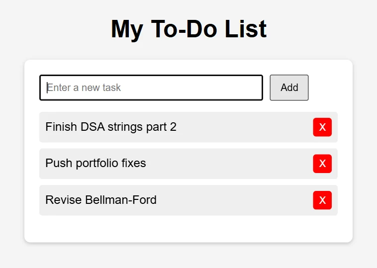

# To-Do List

A small to-do list in a single HTML file, written while learning DOM manipulation.

[Live page](https://to-do-list-livid-eight-13.vercel.app/pink.html)

- Type a task and press **Add**.
- Click a task to mark it done; click again to undo.
- **X** removes the task.

Everything is in [`pink.html`](pink.html): the markup, the styles, and about 30 lines of JavaScript (`createElement`, `classList.toggle`, event listeners). Open it in any browser; there is nothing to install.

Tasks live only in the page, so they are cleared on refresh.
